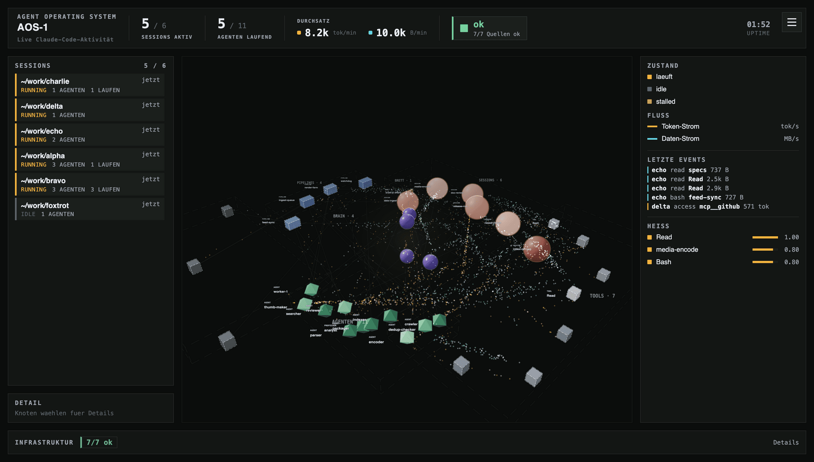
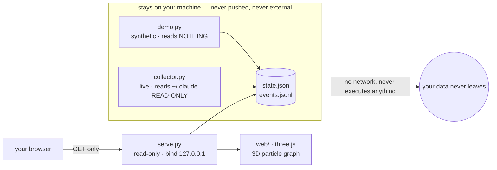

<div align="center">



<br/>

# orbital

**See your whole agent operation at once — in 3D, in real time.**

<em>A real-time 3D "mission control" for an agent operation. Claude sessions, agents, pipelines,<br/>
tools, memory and infrastructure become one rotatable graph, with fine particle data-flows<br/>
streaming along the edges that are live right now. <b>The engine is public; your data never leaves your machine.</b></em>

<br/>


&nbsp;

&nbsp;

&nbsp;

&nbsp;


<br/>

<a href="#why">Why</a> · <a href="#what">What it is</a> · <a href="#architecture">Architecture</a> · <a href="#privacy">Privacy</a> · <a href="#demo">Demo</a> · <a href="#run">Run</a> · <a href="#config">Config</a> · <a href="#layout">Layout</a>

</div>

> **Status — early, but the privacy boundary is the point.** The surface is small and the API may
> still move. What will not move: the default reads nothing real, the server only ever reads from
> disk, and nothing binds to the open internet by default. We would rather ship a narrow tool whose
> privacy is structural than a flashy one whose privacy is a promise.

> **Privacy principle.** The engine is public; **your data stays local.** The default mode is a
> **synthetic demo** that reads nothing real. Live mode reads your local agent workspace
> (`~/.claude`) **read-only** and serves only on the bind address you configure — never `0.0.0.0`.

---

<a id="why"></a>


Once you run more than a couple of agents — sessions spawning sub-agents, pipelines firing, tools
and memory churning — you lose the one thing that used to be free with a single terminal: **the
overview.** Logs scroll past. A dashboard of counters tells you *how many*, not *what is happening
to what, right now.

orbital answers *what is happening right now* as a picture you can turn in your hands. A session
lights up, spawns agents, drives a pipeline; particles stream from a tool to the memory it just
read; a service drops and the infrastructure bar goes amber. You see the shape of the work, not a
wall of text.

> **The honest one-liner:** it is a *live map of an agent operation*, not a metrics dashboard and
> not a profiler. It shows you the system breathing; it does not replace your logs or your traces.

---

<a id="what"></a>


Three small parts, joined only by two files on disk:

| Part | Role |
|---|---|
| **Producer** (`demo.py` *or* `collector.py`) | writes the current state to `state.json` + `events.jsonl` |
| **Server** (`serve.py`) | a GET-only reader that serves those two files and the web app |
| **Web** (`web/`, vendored three.js) | renders the rotatable 3D particle graph in the browser |

The producer is **swappable** — that is the whole design. The server and the web app never know
where the data came from; they only read what is on disk. So "real" and "synthetic" are
interchangeable without touching anything downstream.

| Producer | Reads | For |
|---|---|---|
| `demo.py` | **nothing** — invents a fictional company and animates it over wall-clock time | the public demo, showing what the tool *can* display |
| `collector.py` | `~/.claude` (session transcripts, memory, services) **read-only** | your own live operation |

It is small enough to read in one sitting: **~3,900 lines of its own code across 16 files**, plus a
vendored three.js runtime. No build step, no `npm`, no pip dependencies — Python standard library only.

---

<a id="architecture"></a>


The server holds no collection logic; it validates the request, reads two files, and serves them.
**Everything that touches your data stays on your machine** — the producer reads locally and only
ever *writes* to local disk; the server only *reads* that disk; nothing in the pipeline reaches out.



The data contract between producer and web app — entities, edges, events, the `/state` shape — is
documented in [`SCHEMA.md`](SCHEMA.md). Swap in your own producer by writing that schema; nothing
else has to change.

---

<a id="privacy"></a>


| Property | How it holds |
|---|---|
| **Default leaks nothing** | the shipped default is `mode=demo`; `demo.py` invents everything and opens no real file |
| **Not exposed by default** | `serve.py` binds `127.0.0.1` out of the box — **never `0.0.0.0`**; your real bind lives in a gitignored override |
| **Live is read-only** | `collector.py` only ever opens your files for reading; it never writes to, patches, or executes anything in `~/.claude` |
| **Nothing private in the repo** | operator config (`aos.local.json`), runtime state and logs are gitignored; a leak scanner guards every publish |

Before publishing, a scanner checks that no private marker (absolute home paths, private IP ranges,
operator-specific names) reached a tracked file:

```sh
python3 tools/scan_private.py     # exit 0 = clean, 1 = findings
```

> **Stated honestly.** The scanner is a **net, not a proof** — it catches known patterns, run
> case-insensitively, but human review before any publish stays mandatory. There is no CI isolation
> proof here (this is a viewer, not a sandbox); the guarantee is structural — *local reads, local
> disk, loopback bind by default* — not a test that fails the build.

The full trust boundary, and an honest list of what orbital does **not** defend against, live in
[`THREAT_MODEL.md`](THREAT_MODEL.md).

---

<a id="demo"></a>


`demo.py` is not a static scene. It runs a fictional firm through a ~108-second cycle of phases, so
the graph *does things* while you watch — and exercises every visual the live mode can show:

| Phase | What you see |
|---|---|
| **ingest** / **render** | data-heavy waves — byte-flow dominates, most sessions busy |
| **research** | a token-heavy deep-dive — one session spawns an **agent swarm** that appears and fades |
| **review** | balanced token/data work across the doc sessions |
| **incident** | **a service drops** — the infrastructure bar turns amber, sources read 6/7, ops spikes |
| **quiet** | a real breather — a couple of sessions, few events |

Every name, port and number in the demo is **invented** — it is illustrative, not a benchmark.

---

<a id="run"></a>


```sh
git clone https://github.com/NEO849/orbital
cd orbital
./run.sh                      # synthetic demo (default) -> http://127.0.0.1:8080
```

Open `http://127.0.0.1:8080` and drag to orbit the scene. Requires only `python3` (3.9+); three.js
is vendored, so there is **no build and no `npm`**.

```sh
AOS_PORT=9000 ./run.sh        # a different port
./run.sh live                 # live mode — reads ~/.claude read-only (configure first, see below)
```

---

<a id="config"></a>


`collector/config.py` is the single source of truth, with safe public defaults (`mode=demo`,
`bind=127.0.0.1`, empty live sources). Override it two ways (environment wins over file):

1. **`collector/aos.local.json`** (gitignored) — your real values:
   ```json
   { "mode": "live", "bind": "127.0.0.1", "port": 8080,
     "memory_dir": "/home/<user>/.claude/projects/<proj>/memory" }
   ```
2. **`AOS_*` environment variables** — e.g. `AOS_PORT`, `AOS_BIND`, `AOS_MODE`.

Run `python3 collector/config.py` to print the resolved configuration (no secrets).

---


- The **live collector targets Claude Code's `~/.claude` layout** (transcript JSONL, memory folder,
  services registry). Other setups need adaptation in `collector.py` — the demo mode needs nothing.
- The 3D view needs **WebGL**. On a headless server a screenshot may capture the canvas black (a
  framebuffer race); a real browser renders it fine.
- The server has **no auth layer**. For anything but loopback, put it behind a reverse proxy or a
  private network — do not bind it to the open internet.

---

<a id="layout"></a>


```
collector/   config.py (SSOT) · demo.py (synthetic) · collector.py (live) · serve.py (GET-only)
web/         index.html · palette.js · src/*.js (scene, layout, nodes, flows, hud …) · vendor/ (three.js)
tools/       scan_private.py (the leak gate)
run.sh       one-command launch · SCHEMA.md  the producer<->web data contract
```

---

<div align="center">

**Built by [NEO849](https://github.com/NEO849).** Issues and PRs welcome — see [`CONTRIBUTING.md`](CONTRIBUTING.md) and [`THREAT_MODEL.md`](THREAT_MODEL.md).


&nbsp;


MIT — see [`LICENSE`](LICENSE).

</div>
